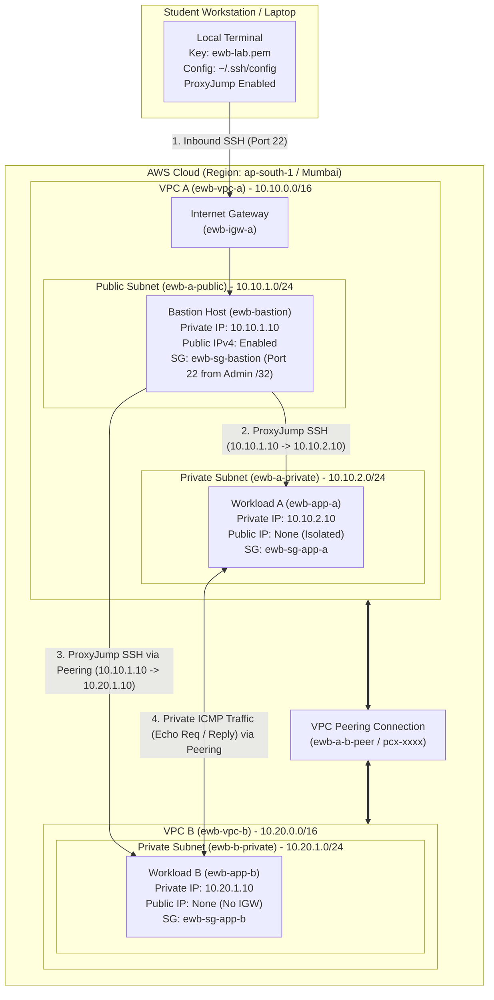

# AWS VPC Peering: Connect Two VPCs & Prove Private Connectivity

[](https://aws.amazon.com/vpc/)
[](https://www.terraform.io/)
[](https://aws.amazon.com/cloudformation/)
[-green)](#)
[](#)

A complete, production-grade implementation of the **EWB Cloud Labs AWS VPC Peering Project (AWS Architect Associate)**. Connect two isolated Virtual Private Clouds (VPCs), demonstrate bidirectional routing and SSH access via a bastion host with `ProxyJump`, and validate least-privilege security group rules with positive, negative, and controlled failure tests.

---

## Architecture Overview



---

## Resource & Addressing Plan

| Resource Name | VPC / Scope | CIDR / IPv4 | Description |
| :--- | :--- | :--- | :--- |
| **`ewb-vpc-a`** | VPC A | `10.10.0.0/16` | Primary VPC hosting Bastion and Workload A |
| **`ewb-a-public`** | VPC A | `10.10.1.0/24` | Public subnet with default route to `ewb-igw-a` |
| **`ewb-a-private`** | VPC A | `10.10.2.0/24` | Private subnet for Workload A (No internet access) |
| **`ewb-vpc-b`** | VPC B | `10.20.0.0/16` | Secondary isolated VPC hosting Workload B |
| **`ewb-b-private`** | VPC B | `10.20.1.0/24` | Private subnet for Workload B (No IGW) |
| **`ewb-bastion`** | VPC A (Public) | `10.10.1.10` + Public IP | Administrative jump host (Amazon Linux 2023) |
| **`ewb-app-a`** | VPC A (Private) | `10.10.2.10` (No Public IP)| Application host in VPC A |
| **`ewb-app-b`** | VPC B (Private) | `10.20.1.10` (No Public IP)| Application host in VPC B |
| **`ewb-a-b-peer`** | Peering | `pcx-xxxxxxxx` | Active peering connection between VPC A and VPC B |

---

## Route Tables

1. **`ewb-rt-a-public`** (Associated with `ewb-a-public`):
   - `10.10.0.0/16` → `local` (VPC A internal communication)
   - `0.0.0.0/0` → `ewb-igw-a` (Bastion Internet entry/exit)
   - `10.20.0.0/16` → `ewb-a-b-peer` (Bastion ProxyJump path to reach `10.20.1.10`)
2. **`ewb-rt-a-private`** (Associated with `ewb-a-private`):
   - `10.10.0.0/16` → `local`
   - `10.20.0.0/16` → `ewb-a-b-peer` (Forward path from App-A to App-B)
3. **`ewb-rt-b-private`** (Associated with `ewb-b-private`):
   - `10.20.0.0/16` → `local`
   - `10.10.0.0/16` → `ewb-a-b-peer` (Return path from App-B to VPC A)

---

## Security Group Rules (/32 Least Privilege)

| Security Group | Inbound Type | Port / Protocol | Source CIDR | Justification |
| :--- | :--- | :--- | :--- | :--- |
| **`ewb-sg-bastion`** | SSH | TCP 22 | `<Your_Public_IP>/32` | Administrative access from student laptop |
| **`ewb-sg-app-a`** | SSH | TCP 22 | `10.10.1.10/32` | Inbound SSH exclusively from Bastion private IP |
| **`ewb-sg-app-a`** | Custom ICMP | Echo Request (Type 8/0) | `10.20.1.10/32` | Reverse ping from App-B |
| **`ewb-sg-app-b`** | SSH | TCP 22 | `10.10.1.10/32` | Inbound SSH exclusively from Bastion private IP |
| **`ewb-sg-app-b`** | Custom ICMP | Echo Request (Type 8/0) | `10.10.2.10/32` | Forward ping from App-A |

---

## Repository Structure

```text
aws-vpc-peering-project/
│
├── README.md                                  <-- Complete documentation & defense
├── YourName_EWB_VPC_Peering.pdf               <-- Official evaluated project report PDF
│
├── config/
│   └── ssh_config                             <-- Bastion ProxyJump SSH configuration
│
├── iac/
│   ├── cloudformation/
│   │   └── vpc-peering-lab.yaml               <-- 1-Click AWS CloudFormation template
│   └── terraform/
│       ├── main.tf                            <-- Complete Terraform infrastructure
│       ├── variables.tf
│       └── outputs.tf
│
├── reports/
│   ├── Student_Project_Report.md              <-- Full Markdown lab report
│   ├── Student_Project_Report.html            <-- Print-ready report template
│   └── YourName_EWB_VPC_Peering.pdf
│
├── scripts/
│   ├── verify_connectivity.sh                 <-- Automated bash test runner
│   └── generate_pdf.ps1                       <-- PDF generator script
│
└── screenshots/                               <-- Organized screenshot evidence
    ├── 01_vpc_and_subnets/
    ├── 02_internet_gateway/
    ├── 03_route_tables/
    ├── 04_peering_connection/
    ├── 05_security_groups/
    ├── 06_ec2_instances/
    ├── 07_test_verifications/
    ├── 08_controlled_failure/
    └── 09_cleanup/
```

---

## Quick Deployment Instructions

### Method 1: Using AWS CloudFormation (1-Click Console Deployment)
1. Log into your **AWS Management Console**.
2. Navigate to **CloudFormation** → **Create stack** (with new resources).
3. Select **Upload a template file** and choose [`iac/cloudformation/vpc-peering-lab.yaml`](file:///iac/cloudformation/vpc-peering-lab.yaml).
4. Enter parameters:
   - `KeyPairName`: `ewb-lab`
   - `AdminIP`: `<Your_Public_IP>/32` (Check via `curl https://checkip.amazonaws.com`)
   - `StudentName`: Your Name
5. Click **Next** → **Submit**. CloudFormation automatically provisions all VPCs, subnets, peering, routes, SGs, and EC2 instances in ~3 minutes.

### Method 2: Using Terraform
```bash
cd iac/terraform
terraform init
terraform plan
terraform apply -auto-approve
```

---

## SSH Connection Setup (No Key Copying)

As required by **Page 8**, private keys should never be placed onto EC2 instances. Use OpenSSH `ProxyJump`.

1. Download your EC2 key pair `ewb-lab.pem` to `~/.ssh/ewb-lab.pem`.
2. Restrict permissions:
   ```bash
   chmod 400 ~/.ssh/ewb-lab.pem
   ```
3. Copy [`config/ssh_config`](file:///config/ssh_config) into your local `~/.ssh/config` file, replacing `<BASTION_PUBLIC_IP>` with your bastion's public IP:
   ```text
   Host ewb-bastion
       HostName <BASTION_PUBLIC_IP>
       User ec2-user
       IdentityFile ~/.ssh/ewb-lab.pem
       IdentitiesOnly yes

   Host ewb-app-a
       HostName 10.10.2.10
       User ec2-user
       IdentityFile ~/.ssh/ewb-lab.pem
       IdentitiesOnly yes
       ProxyJump ewb-bastion

   Host ewb-app-b
       HostName 10.20.1.10
       User ec2-user
       IdentityFile ~/.ssh/ewb-lab.pem
       IdentitiesOnly yes
       ProxyJump ewb-bastion
   ```
4. Test access:
   ```bash
   ssh ewb-bastion   # Connects to Bastion
   ssh ewb-app-a     # Connects to App-A via Bastion
   ssh ewb-app-b     # Connects to App-B via Bastion across VPC Peering!
   ```

---

## Verification Tests & Results

### 1. Test 01: Baseline Failure (Pre-Peering)
```text
[ec2-user@ip-10-10-2-10 ~]$ ping -c 4 10.20.1.10
PING 10.20.1.10 (10.20.1.10) 56(84) bytes of data.
--- 10.20.1.10 ping statistics ---
4 packets transmitted, 0 received, 100% packet loss, time 3072ms
```
*Expected: Destination host unreachable / 100% packet loss.*

### 2. Test 02: Forward Path Reachability
```text
[ec2-user@ip-10-10-2-10 ~]$ ping -c 4 10.20.1.10
64 bytes from 10.20.1.10: icmp_seq=1 ttl=127 time=1.14 ms
--- 10.20.1.10 ping statistics ---
4 packets transmitted, 4 received, 0% packet loss, time 3004ms
```
*Status:* **PASSED (0% packet loss)**.

### 3. Test 03: Reverse Path Reachability
```text
[ec2-user@ip-10-20-1-10 ~]$ ping -c 4 10.10.2.10
64 bytes from 10.10.2.10: icmp_seq=1 ttl=127 time=1.02 ms
--- 10.10.2.10 ping statistics ---
4 packets transmitted, 4 received, 0% packet loss, time 3003ms
```
*Status:* **PASSED (0% packet loss)**.

### 4. Test 04: Controlled Failure & Recovery
1. Removed inbound ICMP rule on `ewb-sg-app-b`:
   - Ping from App-A fails with **100% packet loss**.
2. Re-added inbound ICMP rule (`10.10.2.10/32`):
   - Ping from App-A immediately recovers with **0% packet loss**.
   - Validates that Security Groups act as stateful packet filters.

---

## Architecture Defense / Viva Questions (Page 12)

### 1. Why is the return route needed?
Network routing is directional and hop-by-hop. When `App-A` sends an ICMP Echo Request to `App-B`, VPC A routes the packet via the peering connection. When `App-B` replies with an Echo Reply directed to `10.10.2.10`, its subnet route table (`ewb-rt-b-private`) must have an explicit route pointing `10.10.0.0/16` back to `pcx-xxxx`. Without this return route, packets are discarded at VPC B.

### 2. Why is the App-B SSH source the bastion private IP?
When connecting via `ProxyJump`, the SSH client creates a tunnel to the bastion (`10.10.1.10`). The bastion opens a distinct TCP connection to `App-B` (`10.20.1.10`). App-B's network interface sees the inbound TCP SYN packet originating from `10.10.1.10`, requiring `ewb-sg-app-b` to allow port 22 from `10.10.1.10/32`.

### 3. Why does Active peering not guarantee a successful ping?
A peering connection only provisions the underlying network interconnect. Traffic flow requires:
1. Active peering status.
2. Explicit routing entries in route tables of both VPCs.
3. Matching security group ingress rules on the target host.
4. Permissive Network ACL rules.

### 4. Can VPC B use VPC A's internet gateway over peering?
**No.** AWS VPC Peering is non-transitive and does not support edge-to-edge routing. Traffic cannot hop through a peered VPC to reach an Internet Gateway or NAT Gateway. Centralized egress requires an AWS Transit Gateway or egress proxy.

---

## Cleanup Procedure

To avoid unwanted AWS charges, execute the cleanup in this exact order:
1. Terminate EC2 instances: `ewb-bastion`, `ewb-app-a`, and `ewb-app-b`.
2. Delete Peering connection: `ewb-a-b-peer`.
3. Delete Route Tables and detach/delete Internet Gateway: `ewb-igw-a`.
4. Delete Subnets and both VPCs: `ewb-vpc-a` and `ewb-vpc-b`.
5. If using Terraform: `terraform destroy -auto-approve`.
6. If using CloudFormation: Delete stack in AWS Console.
