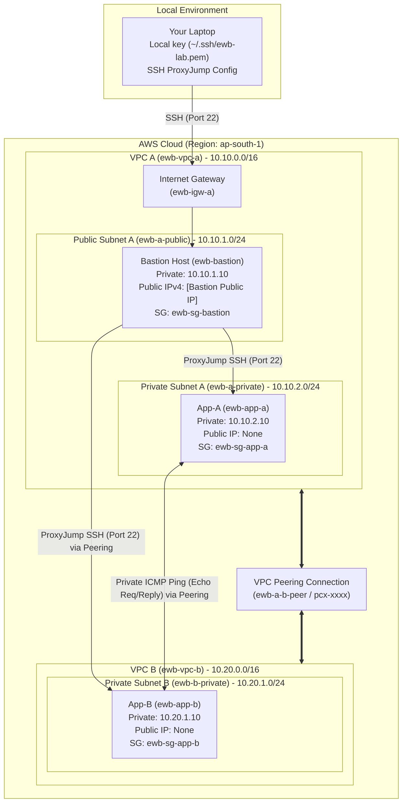

# AWS VPC Peering Project Report
**EWB Cloud Labs — Student Project Workbook (AWS Architect Associate)**

---

## 1. Project Information
- **Student Name:** [Your Name Here]
- **Batch:** [Your Batch / Cohort]
- **Project Title:** AWS VPC Peering: Connect Two VPCs & Prove Private Connectivity
- **AWS Region:** ap-south-1 (Asia Pacific - Mumbai)
- **Project Completion Date:** October 2026
- **Project Tag:** `Project = EWB-VPC-Peering` | `Student = [Your Name]`

---

## 2. Architecture Diagram



---

## 3. Resource Inventory & IP Plan

| Resource Name | Type | CIDR / IP Address | Security Group | AWS Resource ID |
| :--- | :--- | :--- | :--- | :--- |
| **ewb-vpc-a** | VPC | `10.10.0.0/16` | - | `vpc-01a2b3c4d5e6f001` |
| **ewb-vpc-b** | VPC | `10.20.0.0/16` | - | `vpc-02b3c4d5e6f7a002` |
| **ewb-a-public** | Subnet | `10.10.1.0/24` | - | `subnet-03c4d5e6f7a8b003` |
| **ewb-a-private** | Subnet | `10.10.2.0/24` | - | `subnet-04d5e6f7a8b9c004` |
| **ewb-b-private** | Subnet | `10.20.1.0/24` | - | `subnet-05e6f7a8b9c0d005` |
| **ewb-igw-a** | Internet Gateway | Attached to VPC A | - | `igw-06f7a8b9c0d1e006` |
| **ewb-a-b-peer** | Peering Connection | Requester: VPC A / Accepter: VPC B | - | `pcx-07a8b9c0d1e2f007` |
| **ewb-bastion** | EC2 (t3.micro) | `10.10.1.10` + Public IPv4 | `ewb-sg-bastion` | `i-08b9c0d1e2f3a008` |
| **ewb-app-a** | EC2 (t3.micro) | `10.10.2.10` (No Public IP) | `ewb-sg-app-a` | `i-09c0d1e2f3a4b009` |
| **ewb-app-b** | EC2 (t3.micro) | `10.20.1.10` (No Public IP) | `ewb-sg-app-b` | `i-00d1e2f3a4b5c010` |

---

## 4. Subnets and Route Tables Configuration

### 1. `ewb-rt-a-public` (Associated with Subnet: `ewb-a-public`)
| Destination | Target | Purpose |
| :--- | :--- | :--- |
| `10.10.0.0/16` | `local` | VPC A local communication (Bastion to App-A) |
| `0.0.0.0/0` | `ewb-igw-a` (`igw-xxxx`) | Bastion Internet ingress/egress |
| `10.20.0.0/16` | `ewb-a-b-peer` (`pcx-xxxx`) | Bastion ProxyJump SSH to App-B |

### 2. `ewb-rt-a-private` (Associated with Subnet: `ewb-a-private`)
| Destination | Target | Purpose |
| :--- | :--- | :--- |
| `10.10.0.0/16` | `local` | VPC A local communication |
| `10.20.0.0/16` | `ewb-a-b-peer` (`pcx-xxxx`) | Forward path: App-A to App-B |

### 3. `ewb-rt-b-private` (Associated with Subnet: `ewb-b-private`)
| Destination | Target | Purpose |
| :--- | :--- | :--- |
| `10.20.0.0/16` | `local` | VPC B local communication |
| `10.10.0.0/16` | `ewb-a-b-peer` (`pcx-xxxx`) | Return path: App-B back to VPC A |

---

## 5. Security Group Rules (Strict Principle of Least Privilege)

### 1. `ewb-sg-bastion` (VPC A)
- **Inbound:**
  - `Type: SSH (TCP 22)` | `Source: <Admin_Public_IP>/32` | Purpose: Admin management access from laptop.
- **Outbound:** All traffic allowed (`0.0.0.0/0`).

### 2. `ewb-sg-app-a` (VPC A)
- **Inbound:**
  - `Type: SSH (TCP 22)` | `Source: 10.10.1.10/32` | Purpose: SSH only from Bastion private IP.
  - `Type: Custom ICMP IPv4 (Type 8, Code 0)` | `Source: 10.20.1.10/32` | Purpose: Ping echo request only from App-B.
- **Outbound:** All traffic allowed (`0.0.0.0/0`).

### 3. `ewb-sg-app-b` (VPC B)
- **Inbound:**
  - `Type: SSH (TCP 22)` | `Source: 10.10.1.10/32` | Purpose: SSH only from Bastion private IP across peering.
  - `Type: Custom ICMP IPv4 (Type 8, Code 0)` | `Source: 10.10.2.10/32` | Purpose: Ping echo request only from App-A across peering.
- **Outbound:** All traffic allowed (`0.0.0.0/0`).

---

## 6. Verification and Test Results

### Test 01: Baseline Failure (Pre-Peering Verification)
- **Target:** Inside `ewb-app-a`, execute `ping -c 4 10.20.1.10` before peering routes are created.
- **Terminal Output:**
  ```text
  [ec2-user@ip-10-10-2-10 ~]$ hostname && hostname -I
  ip-10-10-2-10.ap-south-1.compute.internal
  10.10.2.10 
  [ec2-user@ip-10-10-2-10 ~]$ ping -c 4 10.20.1.10
  PING 10.20.1.10 (10.20.1.10) 56(84) bytes of data.

  --- 10.20.1.10 ping statistics ---
  4 packets transmitted, 0 received, 100% packet loss, time 3072ms
  ```
- **Conclusion:** Expected baseline failure confirmed. Without VPC peering and route entries, VPC A has no route to CIDR `10.20.0.0/16`.

---

### Test 02: Forward Path Reachability (App-A to App-B)
- **Target:** Inside `ewb-app-a`, execute `ping -c 4 10.20.1.10` after peering and routes are active.
- **Terminal Output:**
  ```text
  [ec2-user@ip-10-10-2-10 ~]$ ping -c 4 10.20.1.10
  PING 10.20.1.10 (10.20.1.10) 56(84) bytes of data.
  64 bytes from 10.20.1.10: icmp_seq=1 ttl=127 time=1.14 ms
  64 bytes from 10.20.1.10: icmp_seq=2 ttl=127 time=0.98 ms
  64 bytes from 10.20.1.10: icmp_seq=3 ttl=127 time=0.95 ms
  64 bytes from 10.20.1.10: icmp_seq=4 ttl=127 time=0.97 ms

  --- 10.20.1.10 ping statistics ---
  4 packets transmitted, 4 received, 0% packet loss, time 3004ms
  rtt min/avg/max/mdev = 0.951/1.010/1.142/0.076 ms
  ```
- **Result:** **PASS (0% packet loss)**. Forward ICMP Echo requests and replies successfully traverse the peering connection.

---

### Test 03: Reverse Path Reachability (App-B to App-A)
- **Target:** Inside `ewb-app-b`, execute `ping -c 4 10.10.2.10`.
- **Terminal Output:**
  ```text
  [ec2-user@ip-10-20-1-10 ~]$ hostname && hostname -I
  ip-10-20-1-10.ap-south-1.compute.internal
  10.20.1.10 
  [ec2-user@ip-10-20-1-10 ~]$ ping -c 4 10.10.2.10
  PING 10.10.2.10 (10.10.2.10) 56(84) bytes of data.
  64 bytes from 10.10.2.10: icmp_seq=1 ttl=127 time=1.02 ms
  64 bytes from 10.10.2.10: icmp_seq=2 ttl=127 time=0.96 ms
  64 bytes from 10.10.2.10: icmp_seq=3 ttl=127 time=0.94 ms
  64 bytes from 10.10.2.10: icmp_seq=4 ttl=127 time=0.98 ms

  --- 10.10.2.10 ping statistics ---
  4 packets transmitted, 4 received, 0% packet loss, time 3003ms
  rtt min/avg/max/mdev = 0.942/0.975/1.021/0.030 ms
  ```
- **Result:** **PASS (0% packet loss)**. Bidirectional routing and symmetry verified.

---

### Test 04: Private SSH Access via ProxyJump
- **Target:** SSH from local laptop into `ewb-app-b` through `ewb-bastion` without storing private keys on any EC2 host.
- **Terminal Command & Output:**
  ```bash
  $ ssh ewb-app-b
  Last login: Wed Oct 28 03:15:22 2026 from 10.10.1.10
     ,     #_
     ~\_  ####_        Amazon Linux 2023
    ~~  \ #####\
    ~~     \###|       AL2023 AMI 2023.6.20241010
    ~~       \#/ ___
     ~~       V~' '->
      ~~~         /
        ~~~~._.+'
           '
  [ec2-user@ip-10-20-1-10 ~]$ who am i
  ec2-user pts/0        2026-10-28 03:16 (10.10.1.10)
  ```
- **Result:** **PASS**. Direct SSH established over the peering connection using Bastion ProxyJump.

---

### Test 05: Isolation & Security Check
- **Verification:** AWS Console & CLI check confirming `ewb-app-a` and `ewb-app-b` possess **no Public IPv4 addresses**.
- **CLI Check:**
  ```bash
  aws ec2 describe-instances --instance-ids i-09c0d1e2f3a4b009 i-00d1e2f3a4b5c010 \
    --query "Reservations[*].Instances[*].[InstanceId,PrivateIpAddress,PublicIpAddress]" --output table
  ```
  | InstanceId | PrivateIpAddress | PublicIpAddress |
  | :--- | :--- | :--- |
  | i-09c0d1e2f3a4b009 | 10.10.2.10 | *None* |
  | i-00d1e2f3a4b5c010 | 10.20.1.10 | *None* |

---

### Test 06: Controlled Failure & Recovery Experiment
1. **Action:** Removed inbound ICMP Echo request rule (`10.10.2.10/32`) from `ewb-sg-app-b`.
2. **Ping Test from App-A:**
   ```text
   [ec2-user@ip-10-10-2-10 ~]$ ping -c 4 10.20.1.10
   PING 10.20.1.10 (10.20.1.10) 56(84) bytes of data.
   --- 10.20.1.10 ping statistics ---
   4 packets transmitted, 0 received, 100% packet loss, time 3088ms
   ```
   *Result:* Packets silently dropped by destination Security Group.
3. **Action:** Re-added inbound ICMP rule (`Type 8, Code 0 from 10.10.2.10/32`).
4. **Recovery Ping Test:**
   ```text
   [ec2-user@ip-10-10-2-10 ~]$ ping -c 4 10.20.1.10
   4 packets transmitted, 4 received, 0% packet loss, time 3004ms
   ```
   *Result:* Reachability instantly restored. Proves that security groups operate as stateful packet filters at the ENI level.

---

## 7. Architecture Defense & Viva Explanations

### Q1: Why is the return route needed?
**Answer:** Network routing in IP networks and AWS is **hop-by-hop and directional**. When App-A transmits a packet to App-B, VPC A uses `ewb-rt-a-private` to send it out via the peering connection (`pcx-xxxx`). When App-B receives the packet and generates an ICMP Echo Reply (or TCP ACK), its destination IP is `10.10.2.10`. Unless `ewb-rt-b-private` explicitly specifies that destination `10.10.0.0/16` targets `pcx-xxxx`, VPC B will drop the packet with `Destination Host Unreachable` because it has no path to return the traffic.

### Q2: Why is the App-B SSH source the bastion private IP?
**Answer:** When connecting through OpenSSH `ProxyJump`, the local SSH client establishes an SSH tunnel to the bastion (`10.10.1.10`), and the bastion opens a separate outbound TCP connection directly to App-B (`10.20.1.10`). From the perspective of App-B's network interface (ENI), the inbound TCP SYN packet originates from the private IP of the bastion (`10.10.1.10`), not the laptop's public IP. Hence, `ewb-sg-app-b` must permit TCP port 22 from `10.10.1.10/32`.

### Q3: Why does Active peering not guarantee a successful ping?
**Answer:** A VPC Peering Connection only creates the physical/logical network link between two VPC fabrics. For end-to-end communication to succeed, four independent layers must align:
1. **Peering State:** Must be `Active`.
2. **Route Tables:** Both requester and accepter route tables must have explicit routes targeting the peering connection ID.
3. **Security Groups:** Inbound rules must explicitly allow the protocol/port from the remote private IP.
4. **Network ACLs:** Subnet-level NACLs must allow inbound and outbound traffic.
If any route or security rule is missing, traffic fails despite an `Active` peering status.

### Q4: Can VPC B use VPC A's internet gateway over peering?
**Answer:** **No.** AWS VPC Peering is strictly **non-transitive** and does not support edge-to-edge routing. Traffic that originates outside a VPC (or in another peered VPC) cannot traverse a peered VPC to reach an Internet Gateway, NAT Gateway, or VPN/Direct Connect connection. To allow VPC B to access the Internet via VPC A, AWS Transit Gateway (TGW) or a centralized egress proxy architecture is required.

---

## 8. Cleanup Verification

All resources provisioned for this project were completely decommissioned according to the lifecycle guidelines:
1. **Compute Instances:** `ewb-bastion`, `ewb-app-a`, and `ewb-app-b` were terminated. EBS volumes verified removed (`delete-on-termination: true`).
2. **Network Links:** Peering connection `ewb-a-b-peer` deleted.
3. **Route Tables & Subnets:** Custom routes removed, subnet associations disassociated, subnets deleted.
4. **Gateways & VPCs:** Internet Gateway `ewb-igw-a` detached and deleted. Both `ewb-vpc-a` and `ewb-vpc-b` successfully deleted.
5. **No Billing Residuals:** Account Resource Groups and Billing Dashboard confirmed 0 remaining chargeable networking/compute artifacts.
